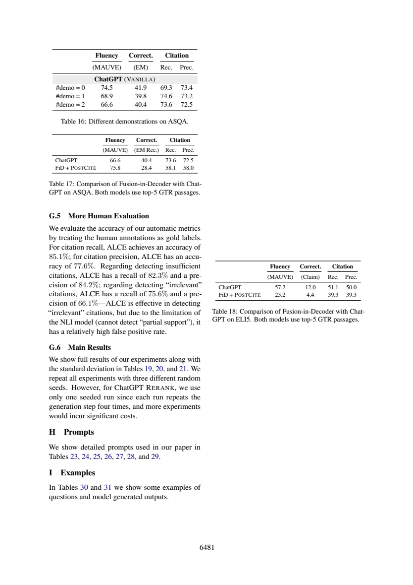

# 示例越多，论文结果就越好吗

这份分享解决一个具体的论文阅读问题，采用“先冻结问题与验收标准→编号原文→真实AI回答→严格定位→语义核查”的流程。范围、任务和作者判断在下文明确分开；不是对原论文实验的复现，也没有宣称模型、提示词或工作流普遍更优。此前我在同项目阅读过这两篇论文；本次主题与既有query位置、引用精度、recall-5等文章不同，实际调用也是新产生的。

## 先做相邻差分，再读“更多更好”

ALCE附录G.3物理页16–17（6480–6481）讨论demonstrations。Table16标题为ASQA，实际显示的是ChatGPT三行；正文还说原始LLaMA随示例数增加更好，但该表没有给出LLaMA数值行。这种文表不完整对应应如实指出，不能替作者补造数据。



|示例数|MAUVE|Correct. EM|Citation Rec.|Citation Prec.|
|---|---:|---:|---:|---:|
|0|74.5|41.9|69.3|73.4|
|1|68.9|39.8|74.6|73.2|
|2|66.6|40.4|73.6|72.5|

0到1示例：EM -2.1、citation recall +5.3个百分点；1到2：EM +0.6、citation recall -1.0个百分点。MAUVE变化为-5.6、-2.3分，不能把所有0–100刻度都称百分点。precision从73.4降到73.2再72.5，因此不存在四项都单调提高的结果。这里是表中均值的算术，没有执行新的论文评测。

作者“至少一个示例确保较高引用recall”的措辞描述此设置；0示例也有69.3，不是“无示例就不会引用”。“不影响correctness”也不是三行精确相等，而是作者对有限变化的概括。1示例在引用recall最高，却不代表综合最优，更不是所有任务的最优数。

G.6同页写主实验三seed、RERANK例外单seed。Table16没有标准差/置信区间；一般重复运行说明不等于这张表给出了可用于显著性检验的完整统计。应区分“未给本表方差”与“从未重复实验”，不能把表中均值说成单次运行。

## 原答核查

D1抄录12值正确，D2差分和MAUVE单位正确，D3也发现Table16缺LLaMA行。问题在D2 limitations称“单次数值”、D3称“单次观测值”，D4虽随后提到三seed，仍说“表未显示三seed平均”。表格未重复印方法说明，并不取消作者的一般重复运行约定；更准确应说“所报告点估计，按通用实验约定理解，缺本表方差，无法判断显著性”。D1说没有均值/方差信息，也应把均值方法与不确定性分开。

定位上D3的A-P16:53–60完整包含G.3，足以核对ChatGPT/LLaMA措辞；D2的表值范围少表标题，仍应连读第7行确认ASQA任务。这个案例提示：输出一句“缺少统计信息”还不够，应明确缺的是运行次数、均值定义还是方差，避免把谨慎写成错误。没有重新训练LLaMA或证明示例数收益。

## 真实记录与复做

本次一轮Bohrium CLI2.8.1原生调用，请求gpt-5-mini/photon，实际返回chenkun/gpt-5-mini。无历史无工具，180秒预算，实际墙钟（含预检及客户端开销）27.391秒，输入2175、输出3814 tokens。completion ID见metadata；精确snapshot/temperature/seed不可得。费用无逐次货币信息，cost=null，不能当0。正文判断由Codex辅助非盲核查，不伪装独立人类评审。

完整[实际输入](run-request.txt)、[预检](run-preflight.json)、[原始响应](run-response.json)、[模型原答](run-output.json)、[元数据](run-metadata.json)、[stderr](run-stderr.txt)均保留。response仅脱敏私人余额。没有重写原答，也没有失败后挑选新答案。本次严格JSON/行范围结果为`ranges_valid`，共7段；这只检查id覆盖、字段存在与行范围，不检测问题语义对应、单位、蕴含或原文是否充分。

本地复查（Python3标准库、无需联网）：

```sh
python validate.py sources.json run-output.json
```

预期以validation.json为准；ranges_valid退出0，range_errors/invalid_json退出1，原始失败保留；请继续逐项比对[编号原文](numbered.txt)、正文审计与[调用前标准](criteria.md)。D1–D4标签存在不表示它们分别答对了问题。

独立重做需从玻尔官方渠道安装Bohrium CLI并手动登录，确保额度。保留这些文件同目录，用原生exe或对应系统原生二进制：

```sh
python replay.py --bohr /absolute/path/to/bohr --condition workflow --out new-run
```

replay先dry-run逐字验证实际message，再调用；现有out拒绝覆盖。Windows .cmd历史上会截断多行参数，原生exe避免这一已遇到的问题；命令行仍需低于Windows长度限制。若代理影响认证，本脚本仅移除子进程HTTP_PROXY/HTTPS_PROXY/ALL_PROXY及小写变量，不修改系统代理。真实输入含非语义UUID，新调用不保证逐字相同，按预先标准核验。失败记录不应删改，网络失败不得伪造成功。

## 文件导航与许可

[task.txt](task.txt)列出确切四项问题；[workflow.txt](workflow.txt)为本次方法；[protocol.md](protocol.md)为运行约束；[protocol-lock.json](protocol-lock.json)记录六个事前文件SHA256（对应本目录同名文件）。[sources.json](sources.json)保留原文页面、物理页和source_id，[SOURCES.md](SOURCES.md)说明作者、版本、页码、原PDF哈希与许可。图是原页核查材料，关键结论都另有文字，不依赖看图取数。

[validate.py](validate.py)是机械检查器；[replay.py](replay.py)保存全新请求与响应。只有本次输入输出进入本作品，未把旧实验重复包装。论文采用CC-BY4.0，原创文字与代码MIT。来源研究归论文作者；本次贡献是具体问题设计、适配编号流程、一次实际玻尔阅读、对原答缺陷的原文核查及可照做教程。
